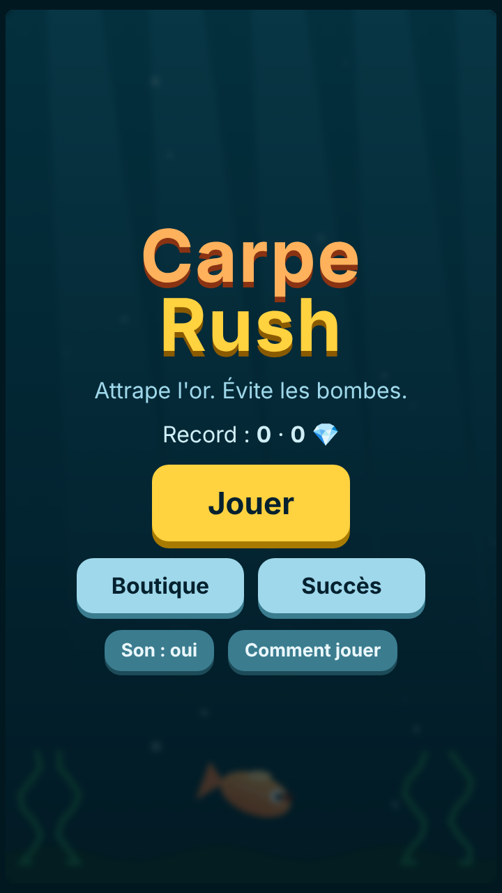
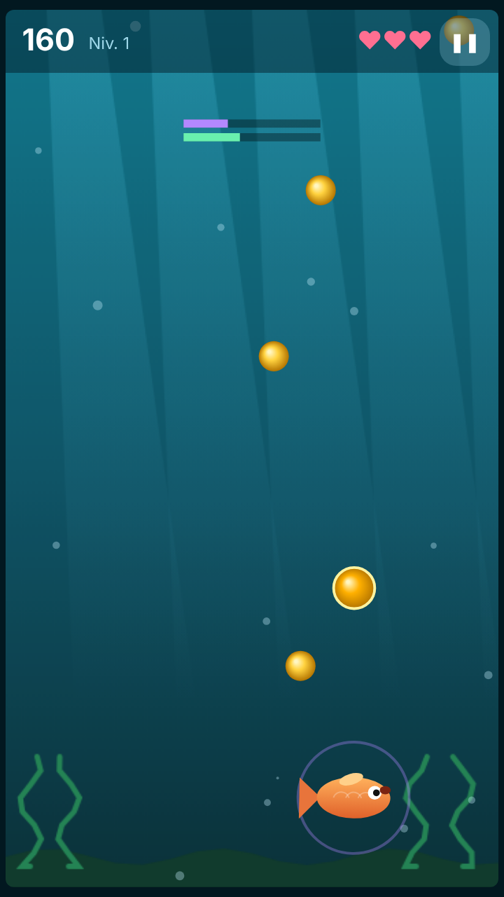
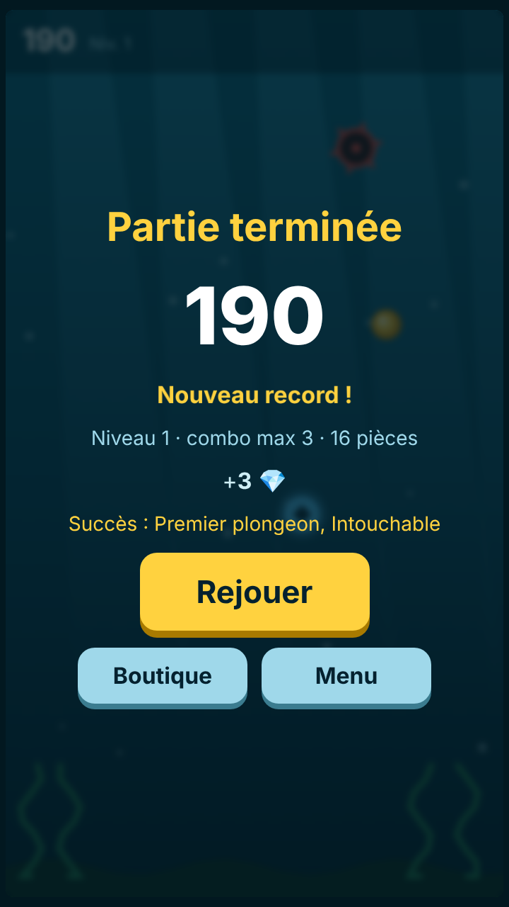

# Carpe Rush

Jeu d'arcade HTML5 qui se joue d'une seule main, sur téléphone ou ordinateur.
Guide ta carpe, attrape l'or, évite les bombes.

**▶ Jouer en ligne :** https://ceeentreprises-dev.github.io/CelesteBip-starter/carpe-rush/
*(lien actif une fois GitHub Pages activé sur le dépôt)*

| Menu | En jeu | Fin de partie |
|---|---|---|
|  |  |  |

## Le jeu

- **Or** : des points. Enchaîne les prises pour monter le combo et le multiplicateur (jusqu'à x5).
- **Bombes** : une vie en moins et le combo retombe à zéro.
- **Bonus** : bouclier, aimant, ralenti, vie supplémentaire.
- **Niveaux** : tout accélère tous les 400 points.
- **Boutique** : chaque partie rapporte des 💎 pour améliorer les bonus.
- **9 succès**, sauvegarde automatique dans le navigateur, sons et musique générés sans fichier audio.

Contrôles : glisse le doigt ou la souris, ou utilise les flèches. P ou Échap pour la pause.

## Lancer le jeu

Aucune installation : ouvre `index.html` dans un navigateur.
Pour itch.io : compresse le contenu du dossier `carpe-rush/` en zip (avec `index.html` à la racine du zip), type de projet **HTML**, taille d'intégration **360 × 640**.

## Structure

```
carpe-rush/
├── index.html        écrans et chargement
├── css/style.css     interface
├── js/config.js      TOUS les réglages (objets, vitesse, boutique, succès)
├── js/game.js        logique du jeu (sans dessin, testable dans Node)
├── js/render.js      dessin canvas, particules, HUD
├── js/audio.js       sons et musique (Web Audio)
├── js/storage.js     sauvegarde locale
├── js/main.js        écrans, contrôles, boucle
└── tools/balance.js  outil d'équilibrage par simulation
```

## Équilibrage

```bash
node tools/balance.js 150
```

Simule 150 parties jouées par un pilote automatique (avec temps de réaction et imprécision) pour trois profils d'améliorations. Résultats actuels :

| Profil | Score médian | Niveau | Durée |
|---|---|---|---|
| Sans amélioration | 700 | 2 | 57 s |
| Améliorations moyennes | 770 | 2 | 68 s |
| Tout au maximum | 1660 | 5 | 117 s |

Options d'URL utiles pour tester : `?bot` (le pilote automatique joue), `?autostart`.

## Licence

MIT (voir `LICENSE` à la racine du dépôt). Code écrit avec l'aide de l'IA.
